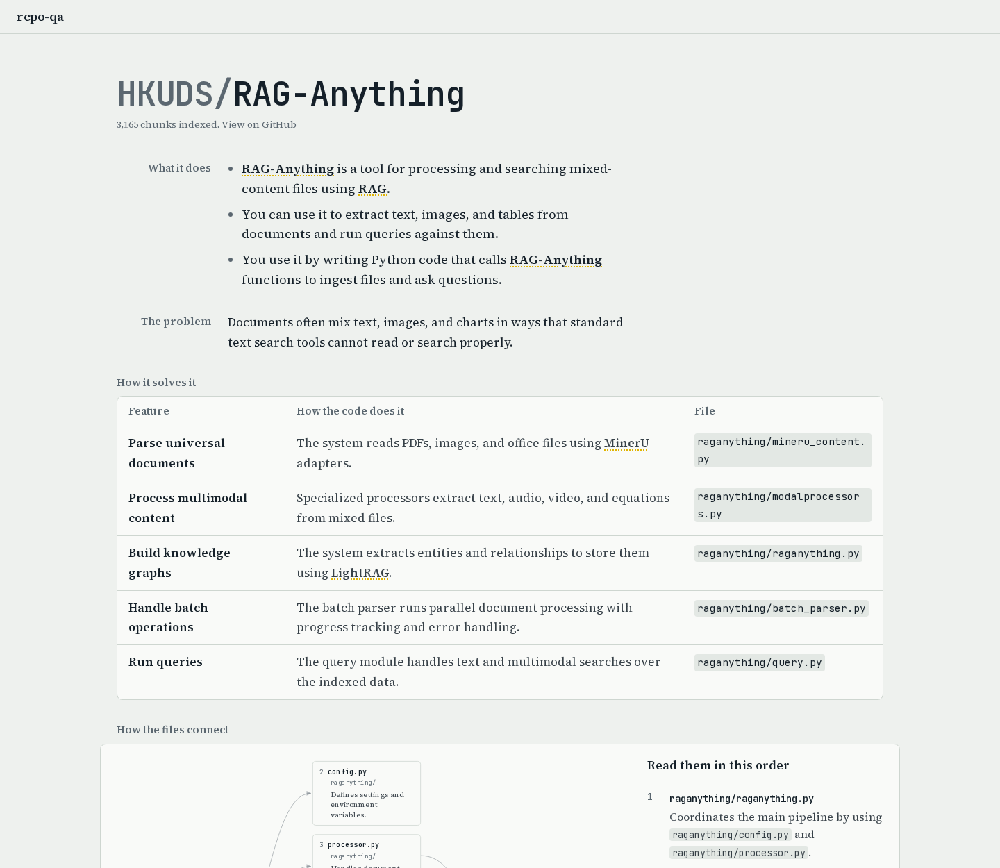

# repo-qa

Ask questions about a code repository and get answers that cite file and line, each citation checked against the code the model actually read. The same index doubles as a code search for your own work, from the terminal or from inside Claude Code.

**Live demo:** https://repoqa.vercel.app (RAG-Anything only, 10 questions an hour per visitor)

## What it does

- **Answers with checked citations.** Every answer points to `file:start-end`; a citation outside the code the model was given is flagged, not shown as fact.
- **Repo brief.** A plain-words overview of a repo (what it does, the problem, how the code solves it, terms) and a file flowchart built from its imports, so a newcomer knows where to start.
- **Code search for building.** `repoqa search "retry a failed request with backoff"` returns the matching code from every indexed repo, ranked, with a match score. No model writes code; you borrow from code that exists.
- **Claude Code tool.** An MCP server (`search_code`, `read_code`, `list_repos`; read-only) gives every Claude Code session the same search.
- **Your own projects.** Index a local folder as well as GitHub repos; private repos can be excluded by name.

## How it works

1. **Index** (`repo_qa/chunker.py`, `indexer.py`): tree-sitter splits Python and JavaScript into functions, class headers and file overviews, and Markdown into sections. A model writes one sentence per file. Chunks go into Chroma with file, name and line numbers.
2. **Retrieve** (`retrieve.py`): meaning search (MiniLM embeddings in Chroma) plus keyword search (BM25), merged by reciprocal rank fusion; the other parts of a long function come along.
3. **Answer** (`answer.py`, `llm.py`): Gemini or Claude answers in a JSON schema with citations; every citation is checked to lie inside the retrieved code.
4. **Agent** (`agent.py`): a LangGraph loop that may search again or open a file, up to 6 times, before answering.
5. **Web** (`api.py`, `web/`): FastAPI holds the key, rate-limits per visitor and caches answers; Next.js serves the pages.
6. **Search and MCP** (`search.py`, `mcp_server.py`): cross-repo ranking by cosine similarity, shared by the CLI and the Claude Code tool.
7. **Evaluate** (`eval/`): a fixed question set with known answers.

Decisions and their reasons: `docs/adr/` (14 records). Terms: `GLOSSARY.md`.

## Evaluation

20 questions on RAG-Anything with known answers (locate, explain, flow, value and unanswerable), checked line by line against the code. Gemini 3.5 Flash-Lite answers; a separate judge call grades each answer against its key facts.

| | Right code retrieved (hit@8) | Accuracy | Citations verified |
|---|---|---|---|
| Meaning search only | 83% | | |
| Keyword search only (BM25) | 89% | | |
| Hybrid (both, merged) | 94% | | |
| Single-shot answer | 94% | 78% (11 correct, 9 partial, 0 wrong) | 100% |
| Agent (LangGraph, may search again) | 94% | 90% (16 correct, 4 partial, 0 wrong) | 100% |

A small benchmark on one repo, judged by the same model family; runs vary by about 3 questions. Details: `eval/RESULTS.md`.

## Deployment

The demo runs on Vercel's free tier with no database: the RAG-Anything index is exported to a numpy file and searched with one matrix product, which returns the same top 20 as Chroma and keeps the back end under Vercel's 500 MB limit (`repo_qa/flat.py`, ADR 0014). `deploy/build_demo.py` builds the bundle and refuses to deploy if it finds a key, a `.env` file or a private repo's name. A Cloud Run image is kept as a backup (ADR 0013).

## Run it locally

    ./run.sh            # back end on :8000, website on :3000; open http://localhost:3000
    ./run.sh --dev      # same, but the website reloads when you edit it

Needs `.env` with `GEMINI_API_KEY` (see `.env.example`). The Claude option uses your own `claude` login.

## Command line

    source ~/.local/share/repo-qa/venv/bin/activate
    python -m repo_qa index test-repos/RAG-Anything
    python -m repo_qa overview test-repos/RAG-Anything
    python -m repo_qa ask test-repos/RAG-Anything "How is the LightRAG instance initialized?"
    repoqa search "split a long function into parts"     # from any folder
    python eval/run_eval.py --retrieval-only               # no model calls
    python -m pytest tests

The Python environment lives outside this folder (the drive is exFAT and cannot hold one).
